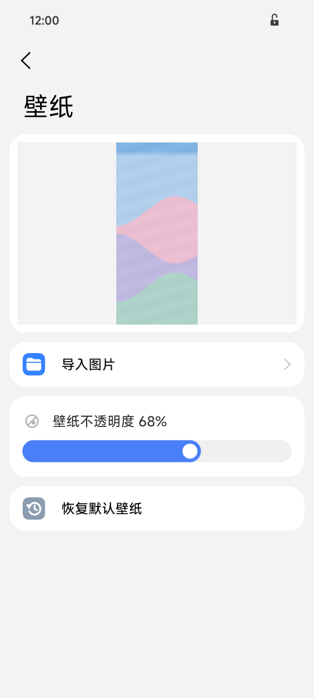

# Skyward Recovery for Redmi K30 Pro

English | [简体中文](README.zh-CN.md)

An unofficial preview of Skyward Recovery for the Redmi K30 Pro (`lmi`). This port builds on Skyward, the Android recovery written in Rust. [Upstream Skyward](https://github.com/kirklin/skyward)

## Screenshots

The Home screen, wallpaper settings and frosted cards in dark mode, rendered on a computer with a sample wallpaper.

<p align="center">
  
  
  
</p>

## Features

### Decryption

Enter the Android lock-screen PIN on the Decrypt page to unlock internal storage. PIN decryption has been tested on the ROM build listed below.

### Installation preflight

The **ADB sideload preflight** verifies the matching Infinity-X update ZIP's signature and SHA-256, then lists the target partitions. Reinstalling that exact ROM was tested with an earlier installer build. [Sideload and reinstall details](docs/lmi.zh-CN.md#临时启动与同版重装)

### Backup and restore

Back up and verify the supported contents of `/data`. Backups appear on the Restore page. Shared storage, including photos and downloads, needs a separate backup. Restore has been tested with a sample app. Restoring all of `/data` is still awaiting device validation. [Backup details](docs/lmi.zh-CN.md#数据备份)

### Wallpaper and appearance

After decryption, import a JPG or PNG from internal storage and set its opacity from 5% to 100%. The **Frosted cards** switch applies to Home and Settings in both themes. Skyward loads the saved wallpaper and switch setting after decryption.

### Other features

- Touch, screen brightness and vibration control.
- Read-only inspection of the system's logical partitions.
- Reboot to Android from the Recovery menu.

## Current limitations

Some upstream menu entries still appear. An unavailable action displays “Unavailable in the UI preview.”

- **Advanced tools.** The file manager, terminal, USB file transfer (MTP), log export, screenshot shortcut and SELinux relabeling are pending. The Wallpaper page has its own image picker.
- **Maintenance and reboot.** Data wipe, factory reset, filesystem checks, repair and formatting are pending. The Mount page shows the logical system partitions read-only. The Reboot menu can return to Android.
- **Installation.** ADB sideload installation accepts the matching full Infinity-X ZIP. General ZIP or IMG flashing, installation from internal storage or a USB drive, online updates and dual boot are pending.
- **Backup and restore.** Backups of `/data` go to internal storage. A full `/data` restore and migration from another ROM still need device testing. Skyward refuses to restore backups tied to the old encryption key after a factory reset.
- **Settings.** Language, theme, brightness and vibration settings last for the current Recovery session. Unlocking storage loads the saved wallpaper, opacity and frosted cards setting.

## Supported device

| Device | Codename | Tested ROM | Build |
| --- | --- | --- | --- |
| Redmi K30 Pro | `lmi` | Unofficial Infinity-X 3.12 (Android 16) | `1793266721` |

Device testing covers this model and ROM build. [Matching Infinity-X build](https://github.com/InSnocent/infinityx-lmi)

## Installing Skyward

Use an unlocked bootloader and Android SDK Platform-Tools. Keep the original Infinity-X Recovery image from the same ROM build so you can roll back. Verify the Skyward image against its published SHA-256 or the checksum generated when you built it. Substitute your image's filename for `skyward-lmi.img` in these commands. [Recorded SHA-256 checksums](docs/lmi.zh-CN.md#sha-256)

### Temporary boot

Enter bootloader Fastboot and check the product codename.

```sh
fastboot getvar product
```

On a Redmi K30 Pro that reports `lmi`, start the image.

```sh
fastboot boot skyward-lmi.img
```

Check that Recovery opens, that you can decrypt storage with your existing PIN, and that **Reboot to system** returns to Android.

### Persistent installation and rollback

Return to bootloader Fastboot, check the product codename again and flash the tested image.

```sh
fastboot flash recovery skyward-lmi.img
fastboot reboot
```

Once Android starts, power off and hold Volume Up and Power to enter Skyward. To roll back, flash the original Infinity-X Recovery for the installed build to the same partition. [Rollback steps](docs/lmi.zh-CN.md#永久安装与回退)

## Building

Build on Linux or WSL with Rust, the `aarch64-linux-android` target and Android NDK r29. Use the base Recovery and build inputs from the matching Infinity-X build. [Build commands and inputs](docs/lmi.zh-CN.md#从源码构建)

## License

[GPL-3.0-or-later](LICENSE)
