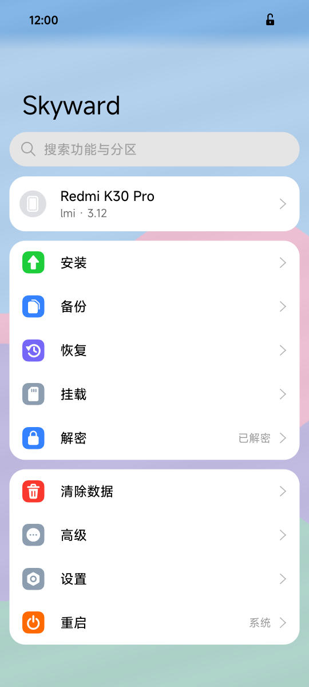
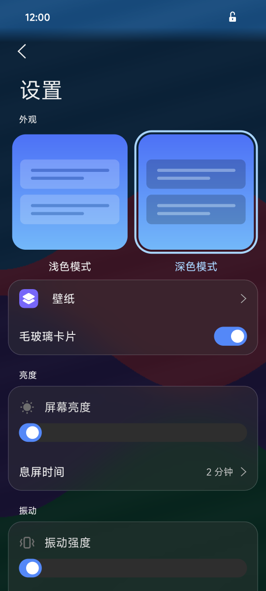

# Skyward Recovery for Redmi K30 Pro

English | [简体中文](README.zh-CN.md)

An unofficial preview of Skyward Recovery for the Redmi K30 Pro (`lmi`). This port builds on Skyward, the Android recovery written in Rust. The features below describe the current source; previously released or installed images may not include the latest changes. [Upstream Skyward](https://github.com/kirklin/skyward)

The lmi v1.2.3 release builds on upstream Skyward v0.3.1. It was tested on a Redmi K30 Pro by formatting Data, installing official LineageOS 23.2 and completing its first boot.

## Screenshots

The Home screen, wallpaper settings and frosted cards in dark mode, rendered on a computer with a sample wallpaper.

<p align="center">
  
  
  
</p>

## Features

### Decryption

Enter the Android lock-screen PIN on the Decrypt page to unlock internal storage. PIN decryption has been tested on the ROM build listed below.

### ZIP installation

ADB sideload, decrypted internal storage and OTG USB drives accept complete `lmi` block OTAs and legacy script ZIPs that contain `update-binary`. The confirmation screen shows the file's SHA-256 and signature status. It also lists the declared device and partitions for a complete ROM. A ZIP without a trusted signature needs an explicit exception for that file, then a full swipe. Go back to cancel.

ADB sideload preflight checks signatures and package structure without running the installer. A ZIP signed with the public AOSP test key can pass preflight with a source warning and still needs a one-time exception to install. A previous build tested reinstalling the matching Infinity-X ROM over ADB sideload. The v1.2.3 ADB flow was used to install LineageOS on the device. [ZIP formats and tests](docs/lmi.zh-CN.md#通用-zip-安装)

### Local boot and recovery images

After decryption, open **Install → Install from internal storage** and choose an `.img`. Skyward inspects the ramdisk, shows the inferred `boot` or `recovery` partition and the SHA-256 of the selected file, and waits for a swipe. Compare the hash with a trusted copy for your exact device and build. After writing, Skyward reads the entire partition back and checks it against the prepared image.

### Backup and restore

Back up and verify the supported contents of `/data`. Backups appear on the Restore page. **Verify backup** independently checks the manifest, volume lengths and content digests without restoring data, and can be stopped. Stopping and a complete recheck have been validated on the supported lmi build. Choose Shared files to include the owner's photos and downloads. Shared files restore into a new folder under Skyward/restored. Restore has been tested with a sample app. Restoring all of `/data` is still awaiting device validation. [Backup details](docs/lmi.zh-CN.md#数据备份)

Skyward can list and verify backups on FAT32 and exFAT drives connected over OTG before decryption. The development candidate adds backing up data to a USB drive and restoring it from one after decryption. Read-only mounting, verification, reconnecting, canceling a backup, and backing up and restoring a synthetic fixture were tested on an exFAT drive. FAT32 and a full data restore still need device testing.

### Wallpaper and appearance

After decryption, choose a JPG or PNG from internal storage. Drag and zoom the picture to frame it for the screen. The dimmed part outside the frame provides a reference as you adjust the crop. Tap **Apply wallpaper** to save. Wallpaper opacity ranges from 5% to 100%. The **Frosted cards** switch applies to the main pages in both themes. Skyward loads the saved wallpaper and switch setting after decryption.

### Other features

- Basic preferences save to `/metadata/skyward/settings.json` and load before data decryption. Language can be changed in Settings before decryption.
- Touch, screen brightness and vibration control.
- Read-only inspection of the system's logical partitions.
- Reboot to Android from the Recovery menu.
- Browse decrypted internal storage in the file manager; rename and copy have been tested with a sample file. The terminal, USB file transfer (MTP), log export and screenshots have received basic device testing.

## Current limitations

Some upstream menu entries still appear. An unavailable action displays “Unavailable in the UI preview.”

- **Advanced tools.** Other file manager write operations and large file sets need further testing. Names containing non-UTF-8 bytes are shown but cannot be operated on in the GUI; MTP omits names with non-UTF-8 bytes or longer than its protocol can represent. MTP temporarily withdraws internal storage during file writes, text editing and terminal jobs. Background processes that deliberately leave the terminal session cannot be fully tracked; ensure they have stopped before backup, restore or installation. SELinux relabeling is not yet adapted.
- **Maintenance and reboot.** Advanced wipe offers independent choices for private app data, internal storage, app caches, system caches and Dalvik / ART cache. A verified physical cache partition can also be selected. Format data opens a separate confirmation page and recreates encrypted user storage on reboot. Format data and file-based encryption on the first LineageOS boot were verified on the Redmi K30 Pro. The Mount page lists the read-only logical system partitions. The Reboot menu can return to Android.
- **Installation.** ADB sideload of the official LineageOS 23.2 build and its first boot were verified on the Redmi K30 Pro. Actual ROM writes from internal or USB storage and compatibility with individual script ZIPs still need device testing. A/B payloads, incremental OTAs and second-system packages are unsupported. Local IMG installation supports only the physical `boot` and `recovery` partitions on `lmi`, with an Android v2 header, 4096-byte pages, a kernel and a size up to 128 MiB. Generic images are not authenticated, and Skyward cannot establish their device compatibility. USB IMG installation, online updates and other IMG targets remain unimplemented.

## Supported device

| Device | Codename | Tested ROM | Build |
| --- | --- | --- | --- |
| Redmi K30 Pro | `lmi` | Unofficial Infinity-X 3.12 (Android 16) | `1793266721` |

Apart from the LineageOS installation test, device testing used this model and ROM build. [Matching Infinity-X build](https://github.com/InSnocent/infinityx-lmi)

## Installing Skyward

Use an unlocked bootloader and Android SDK Platform-Tools. Keep the original Infinity-X Recovery image from the same ROM build so you can roll back. Verify the Skyward image against its published SHA-256 or the checksum generated when you built it. Substitute your image's filename for `skyward-lmi.img` in these commands. [Recorded SHA-256 checksums](docs/lmi.zh-CN.md#sha-256)

### Temporary boot

Enter bootloader Fastboot and check the product codename.

```sh
fastboot getvar product
```

On a Redmi K30 Pro that reports `lmi`, start the image.

```sh
fastboot boot skyward-lmi.img
```

Check that Recovery opens, that you can decrypt storage with your existing PIN, and that **Reboot to system** returns to Android.

### Persistent installation and rollback

Return to bootloader Fastboot, check the product codename again and flash the tested image.

```sh
fastboot flash recovery skyward-lmi.img
fastboot reboot
```

Once Android starts, power off and hold Volume Up and Power to enter Skyward. To roll back, flash the original Infinity-X Recovery for the installed build to the same partition. [Rollback steps](docs/lmi.zh-CN.md#永久安装与回退)

## Building

Build on Linux or WSL with Rust, the `aarch64-linux-android` target and Android NDK r29. Use the base Recovery and build inputs from the matching Infinity-X build. [Build commands and inputs](docs/lmi.zh-CN.md#从源码构建)

## License

[GPL-3.0-or-later](LICENSE)
