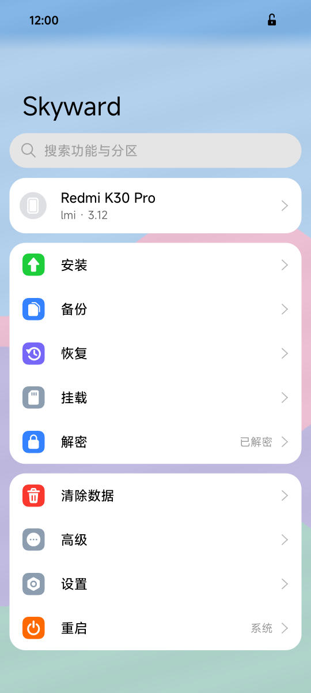
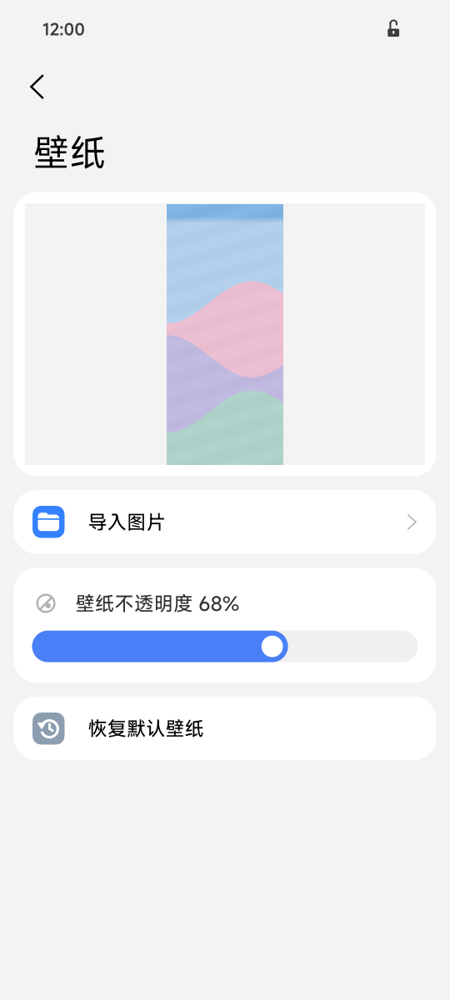
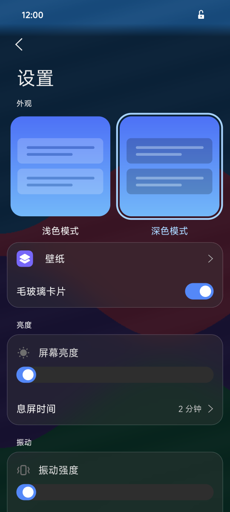

# Skyward Recovery · 红米 K30 Pro

[English](README.md) | 简体中文

Skyward Recovery 的红米 K30 Pro（`lmi`）非官方移植，当前处于预览阶段。Skyward 是用 Rust 编写的 Android Recovery。下列功能描述当前源码；此前发布或已安装的镜像可能尚未包含最新改动。 [上游 Skyward](https://github.com/kirklin/skyward)

本分支已合入上游 Skyward v0.3.1。同步版完成真机验证前，下文的功能实测记录对应 lmi v1.1.0 发行版。

## 截图

图中依次为首页、壁纸设置和深色毛玻璃卡片。界面由电脑端渲染，使用示例壁纸。

<p align="center">
  
  
  
</p>

## 功能

### 解密

在「解密」中输入当前 Android 锁屏 PIN，解锁内部存储。PIN 解密已在下表所列 ROM 构建上实测。

### 安装预检

「ADB sideload 只读预检」会核对匹配的 Infinity-X 完整 ZIP 的签名和 SHA-256，并列出安装目标分区。解密后也可以从内部存储选择同一 ZIP：真机已验证到确认页面，并用无分区写入的模拟包测试了后续读取流程；实际本地 ROM 写入尚未验证。指定同版 ROM 的 ADB sideload 重装在较早的安装版上验证过；该次重装后 Root 失效，原 Recovery 再次出现。 [预检与重装说明](docs/lmi.zh-CN.md#临时启动与同版重装)

在内部存储或文件管理中点选 ZIP 会先进入只读校验页。校验期间可以返回取消。通过后，确认页列出文件名、机型和目标分区，滑动「滑动以刷入 ZIP」才会执行安装。

### 本地刷入 boot 和 recovery 镜像

解密后打开「安装 → 从内部存储安装」，选择 `.img`。Skyward 根据 ramdisk 判断目标是 `boot` 还是 `recovery`，并显示所选文件的完整 SHA-256。请与可信来源为同一机型和系统构建提供的摘要核对，确认后滑动刷入。写入结束后，Skyward 会回读整个目标分区，并核对完整镜像的 SHA-256。 [镜像格式与操作说明](docs/lmi.zh-CN.md#本地-img-刷入)

### 备份和恢复

备份 `/data` 中受支持的内容，并在备份结束后回读校验。可在「恢复」中查看备份，并选择「校验备份」单独检查清单、分卷长度和内容摘要；支持中途停止，不执行恢复。已在支持的 lmi 构建上验证停止及重新完整校验。照片和下载等共享存储内容需要单独备份。恢复流程已用测试应用验证，整份 `/data` 写回仍待实机验证。 [备份说明](docs/lmi.zh-CN.md#数据备份)

### 壁纸和外观

解密后可从内部存储选择 JPG 或 PNG。在裁剪页拖动图片，按屏幕比例取景，也可以用滑块缩放。框外显示压暗的原图，便于对齐主体。点「应用壁纸」后保存。壁纸不透明度可在 5%–100% 之间调节。开启「设置 → 外观 → 毛玻璃卡片」后，主要页面在浅色、深色模式下都能显示壁纸和毛玻璃。再次进入 Recovery 并解密时，会加载保存的壁纸和开关状态。

### 其他功能

- 基础设置保存到 `/metadata/skyward/settings.json`，在解密前即可恢复和保存。可在「设置 → 语言」中直接切换语言，无需解密。
- 支持触摸、亮度调节和振动反馈。
- 可只读查看系统逻辑分区。
- 可从 Recovery 菜单重启到 Android。
- 文件管理可浏览解密后的内部存储，重命名和复制已用测试文件验证；终端、USB 文件传输（MTP）、日志导出和截图已在真机进行基本验证。

## 当前限制

部分上游菜单仍会显示。点到尚未接入的操作时，界面会提示「此操作在界面测试中停用」。

- **高级工具**。文件管理的其他写入操作及大量文件处理仍需进一步验证；包含非 UTF-8 字节的文件名可显示，但暂不能通过图形界面操作；MTP 不显示非 UTF-8 名称或超过协议长度上限的名称。文件管理写入、文本编辑及终端任务期间，MTP 会暂时撤出内部存储。终端主动脱离会话的后台进程无法完全追踪，备份、恢复和安装前需自行确认它们已结束。SELinux 上下文修复尚未适配。
- **维护和重启**。「清除数据」、恢复出厂设置、文件系统检查、修复及格式化尚未接入。挂载页只读显示系统逻辑分区。重启菜单目前可返回 Android。
- **安装**。系统 ZIP 仅支持匹配的 Infinity-X 完整包，从内部存储写入正式 ROM 仍待实测。IMG 仅支持 `lmi` 的独立 `boot` 和 `recovery` 分区，要求 Android v2 引导头、4096 字节页、包含内核，文件最大 128 MiB。通用镜像无法自动证明机型匹配，安装器也不验证 IMG 的签名或来源。其他分区、通用 ZIP、从 U 盘安装、在线更新和双系统尚未适配。
- **备份与恢复**。目前支持把 `/data` 的备份写到手机内部存储；名称含非 UTF-8 字节的备份目录不会列出。整份 `/data` 写回及从其他 ROM 迁移尚未验证。恢复出厂设置后，Skyward 会拒绝写入使用旧加密密钥的备份。
- **设置与壁纸**。旧版内部存储配置会在首次解密后迁移。壁纸、不透明度和毛玻璃开关在内部存储解密后加载。

## 支持的机型

| 机型 | 代号 | 已验证的 ROM | 构建号 |
| --- | --- | --- | --- |
| 红米 K30 Pro | `lmi` | Infinity-X 3.12 非官方版（Android 16） | `1793266721` |

实测范围为表中的机型和 ROM 构建。 [对应的 Infinity-X 构建](https://github.com/InSnocent/infinityx-lmi)

## 安装 Skyward

准备已解锁的 Bootloader、Android SDK Platform-Tools，以及与当前系统配套的原 Infinity-X Recovery 镜像。使用发布时提供或构建时生成的 SHA-256 校验 Skyward 镜像。执行下方命令时，把 `skyward-lmi.img` 换成实际镜像文件名。 [已记录的 SHA-256](docs/lmi.zh-CN.md#sha-256)

### 临时启动

进入 Bootloader 的 FASTBOOT，核对设备代号。

```sh
fastboot getvar product
```

确认手机是红米 K30 Pro 且返回 `lmi` 后，临时启动镜像。

```sh
fastboot boot skyward-lmi.img
```

确认能进入 Skyward、用原 PIN 解密，并从「重启」菜单返回 Android。

### 常驻安装与回退

再次进入 Bootloader 的 FASTBOOT，核对设备代号后刷入已测试的镜像。

```sh
fastboot flash recovery skyward-lmi.img
fastboot reboot
```

Android 启动后关机，同时按住音量上和电源键进入 Skyward。需要回退时，把当前 ROM 配套的原 Infinity-X Recovery 刷回同一分区。 [回退步骤](docs/lmi.zh-CN.md#永久安装与回退)

## 构建

使用 Linux 或 WSL、Rust 的 `aarch64-linux-android` 目标和 Android NDK r29。基础 Recovery 和其他打包输入取自对应的 Infinity-X 构建。 [构建命令与输入文件](docs/lmi.zh-CN.md#从源码构建)

## 许可证

[GPL-3.0-or-later](LICENSE)
